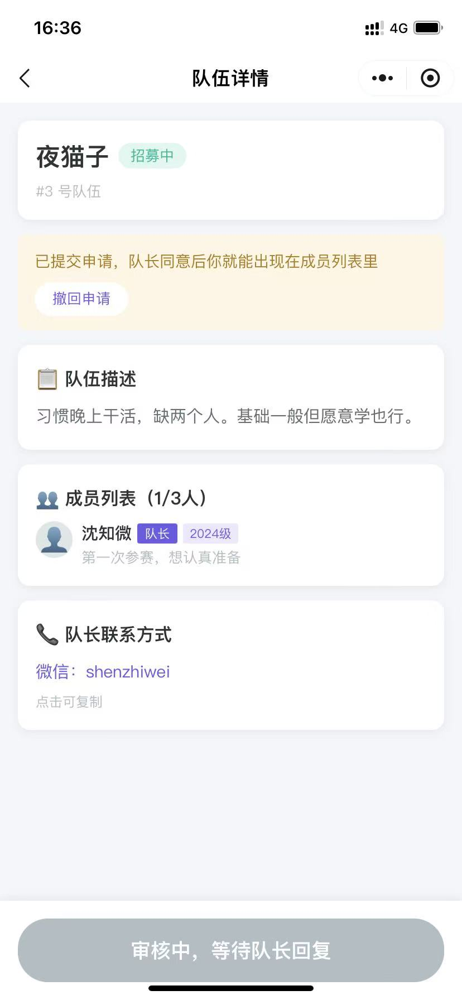
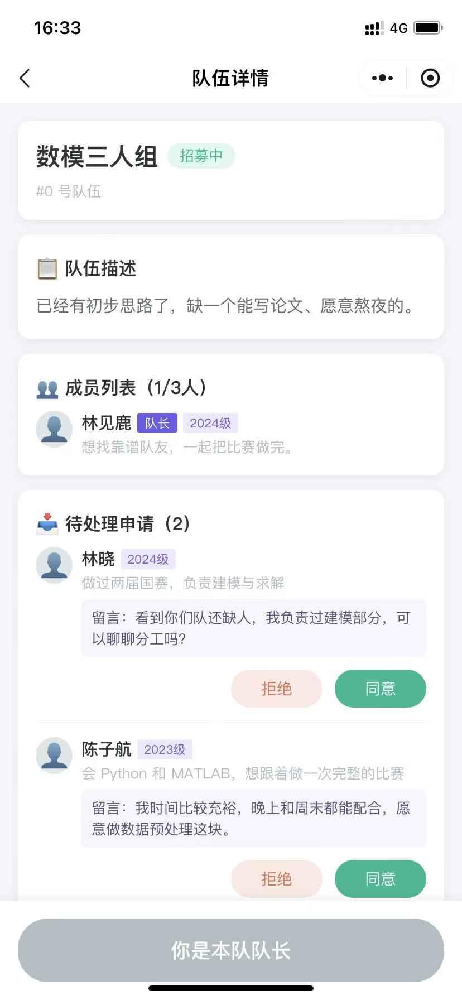

# 组师爺 · 校园竞赛组队平台

一个用**微信小程序 + 云开发**做的校园组队工具，把「群里喊人凑队」这件事变成有赛事、有编号、有申请审核的结构化流程。

数学建模、程序设计、机器人大赛……组队信息通常散落在几十个微信群聊记录里，找不到、问不清、还容易被刷过去。这个小程序把每场赛事做成一个独立入口，队伍有固定编号可以检索，想加入就提申请，队长同意后自动进队。

---

## 功能一览

| 模块 | 状态 | 说明 |
| --- | --- | --- |
| 首页导航 | ✅ | 四个入口，赛事已开放，拼车 / 运动 / 游戏为占位 |
| 赛事列表 | ✅ | 按创建时间倒序展示 |
| 赛事详情 | ✅ | 云存储 `cloud://` 图片自动换取临时链接 |
| 队伍列表 | ✅ | 招募中 / 全部筛选、分页加载、`#编号` 搜索定位 |
| 创建队伍 | ✅ | 编号与名额由服务端分配，队长信息自动写入 |
| 队伍详情 | ✅ | 成员列表、队长标识、空位提示 |
| **联系方式保护** | ✅ | 仅队长与已通过审核的成员可见，独立集合隔离，非成员响应里不带该字段 |
| **申请加入** | ✅ | 留言申请、状态回显、重复申请拦截 |
| **申请撤回** | ✅ | 提交后可撤回，撤回后可重新申请 |
| **队长审核** | ✅ | 待处理申请列表、同意 / 拒绝、事务保证不超员 |
| **我的队伍** | ✅ | 聚合我发起的、我加入的队伍 |
| 个人信息 | ✅ | 昵称、年级、简介，申请前强制补全 |
| **内容审核** | ✅ | 建队、申请留言、个人资料落库前统一过本地规则 + 官方接口 |
| 消息通知 | 🚧 | 见 Roadmap |

## 界面预览

<table>
<tr>
<td width="50%" align="center" valign="top"><br /><sub><b>首页</b>：赛事入口与「我的队伍」聚合</sub></td>
<td width="50%" align="center" valign="top"><br /><sub><b>队伍列表</b>：<code>#编号</code> 检索、满员筛选</sub></td>
</tr>
<tr>
<td width="50%" align="center" valign="top"><br /><sub><b>队伍详情</b>：审核中状态，联系方式对非成员锁定</sub></td>
<td width="50%" align="center" valign="top"><br /><sub><b>队长审核</b>：名额进度、留言、同意 / 拒绝</sub></td>
</tr>
</table>

四张图连起来是一条完整路径：**发现赛事 → 筛选队伍 → 提交申请 → 队长处理**。

## 技术栈

- 微信小程序原生框架（WXML / WXSS / JavaScript），无第三方 UI 库
- 云开发：云数据库（文档型）、云函数、云存储
- 基础库 `3.16.2`

## 目录结构

```
zushiyie-comp-team/
├── cloudfunctions/
│   ├── teamApply/              # 入队申请与审核（核心业务云函数）
│   ├── teamCreate/             # 创建队伍（编号、名额、队长快照都由服务端算）
│   ├── userSave/               # 保存个人资料（昵称与简介在此过内容审核）
│   ├── getUserOpenId/          # 获取当前用户 openid
│   ├── initDb/                 # 一次性初始化：建集合 + 灌演示数据
│   └── checkOpenapi/           # 内容安全接口探路工具（验证完可删）
├── docs/
│   ├── events.example.json     # 赛事导入模板（JSON Lines，照格式改完在控制台导入）
│   └── screenshots/            # 界面预览截图
├── miniprogram/
│   ├── pages/
│   │   ├── index/              # 首页导航
│   │   ├── event-list/         # 赛事列表（分页）
│   │   ├── event-detail/       # 赛事详情
│   │   ├── team-detail/        # 某赛事下的队伍列表 + 筛选 + 分页
│   │   ├── team-create/        # 创建队伍
│   │   ├── team-detail-view/   # 队伍详情 / 申请加入 / 队长审核
│   │   ├── my-teams/           # 我的队伍
│   │   └── profile/            # 个人信息
│   ├── utils/
│   │   └── auth.js             # 统一获取并缓存 openid
│   └── app.js                  # 云开发环境初始化
├── scripts/
│   └── test-moderation.js      # 审核规则自测（本地运行，不上传）
├── .gitignore
├── LICENSE
└── project.config.json
```

## 数据模型

### `users` — 用户资料

| 字段 | 类型 | 说明 |
| --- | --- | --- |
| `_openid` | string | 微信自动写入，用户唯一标识 |
| `nickName` | string | 昵称 |
| `grade` | string | 年级（大一 ~ 研究生及以上） |
| `bio` | string | 个人简介，申请时会一并展示给队长 |
| `avatarUrl` | string | 头像 |
| `createdAt` / `updatedAt` | Date | |

### `events` — 赛事

| 字段 | 类型 | 说明 |
| --- | --- | --- |
| `title` | string | 赛事名称 |
| `description` | string | 赛事说明 |
| `imageUrl` | string | 云存储 fileID（`cloud://` 开头） |
| `maxTeamSize` | number | 每队人数上限，创建队伍时强校验 |
| `canTeamUp` | boolean | 是否开放组队。为 `false` 时赛事详情页不显示「去组队」按钮 |
| `teamCount` | number | 建队计数器，下一个队伍编号由它分配；并发建队靠事务保证不重号 |
| `createTime` | Date | 列表排序依据 |

**批量添加赛事**：`events` 没有后台界面，加比赛走控制台「导入」。仓库里的 `docs/events.example.json` 是可直接导入的样例，改内容、换 `_id` 即可。

1. 云开发控制台 → 数据库 → `events` → 右上「导入」→ 选择该文件，冲突处理选 `Insert`
2. 文件是 **JSON Lines** 格式：每行一个完整对象，不包在 `[...]` 里，行与行之间不加逗号
3. `canTeamUp` 必须是裸的 `true` / `false`（写成字符串 `"false"` 仍会被判为真值，按钮照样出现）；`maxTeamSize` 必须是数字
4. `createTime` 必须写成 `{"$date":"2027-09-01T10:00:00.000Z"}`。直接写 `"2027-09-01T10:00:00.000Z"` 会被当成字符串，与 `initDb` 写入的 Date 混排时排序会错——字符串整体排在日期之后，新赛事会沉到列表末尾

`teamCount` 不用填，第一次有人在该赛事建队时由 `teamCreate` 自动补上。

### `teams_event` — 参赛队伍

| 字段 | 类型 | 说明 |
| --- | --- | --- |
| `eventId` | string | 所属赛事 |
| `teamNumber` | number | 队伍编号，列表里用 `#编号` 搜索 |
| `teamName` | string | 队伍名称 |
| `description` | string | 队伍描述 |
| `maxSize` | number | 人数上限 |
| `isFull` | boolean | 是否满员 |
| `members` | array | 成员数组，元素见下 |
| `creatorOpenid` | string | 队长 openid，**所有权限校验的依据** |
| `createTime` | Date | |

> 这里**没有** `contact` 字段。联系方式放在 `team_contacts`，否则会跟着可读集合一起公开。

`members[]` 元素结构：

```json
{
  "openid": "oXXXX",
  "name": "陈同学",
  "grade": "大二",
  "avatar": "👤",
  "role": "队长",
  "isLeader": true,
  "desc": "擅长 Python 与可视化"
}
```

### `applications` — 入队申请

| 字段 | 类型 | 说明 |
| --- | --- | --- |
| `_id` | string | 固定为 `${teamId}__${openid}`，天然去重 |
| `teamId` / `eventId` / `teamName` | string | 冗余字段，便于列表直接展示 |
| `teamLeaderOpenid` | string | 队长 openid（冗余字段，便于后续按队长维度查询） |
| `applicant` | object | 申请人信息快照 `{ openid, name, grade, desc, avatar }` |
| `message` | string | 申请留言，上限 80 字 |
| `status` | string | `pending` / `approved` / `rejected` / `cancelled` |
| `createTime` / `handleTime` | Date | |
| `handlerOpenid` | string | 处理人 openid |

状态流转：

```
none ──申请──> pending ──同意──> approved（写入 members，占一个名额）
                  │
                  ├──拒绝──> rejected ──重新申请──> pending
                  └──撤回──> cancelled ──重新申请──> pending
```

### `team_contacts` — 队长联系方式

| 字段 | 类型 | 说明 |
| --- | --- | --- |
| `_id` | string | 等于 `teamId`，一队一条 |
| `teamId` | string | 所属队伍 |
| `contact` | string | 队长微信 / QQ / 手机号 |
| `creatorOpenid` | string | 队长 openid，迁移与排查用 |
| `createTime` | Date | |

单独建一个集合、并把权限设为「所有用户不可读写」，是因为队伍列表本身必须公开可读——联系方式若留在 `teams_event` 里，任何人打开 Console 就能批量拉走所有队长的微信号。读取只走 `teamApply` 的 `context` 动作，云函数先判定「你是不是队长或已通过审核的成员」，不是就不在响应里返回这个字段，抓包也拿不到。

## 快速开始

### 1. 导入项目

微信开发者工具 → 导入项目 → 选择本目录。

### 2. 配置云开发环境

`miniprogram/app.js` 里把 `env` 换成你自己的云环境 ID（云开发控制台首页可查）：

```js
globalData: {
  env: 'your-env-id'
}
```

同时把自己的 `appid` 写进 `project.config.json`。

### 3. 部署云函数

有五个云函数需要部署：`teamApply`、`teamCreate`、`userSave`、`getUserOpenId`、`initDb`。在 `cloudfunctions/` 下对应的目录分别右键 → **上传并部署：云端安装依赖**。

> 目录里还有个 `checkOpenapi`，它是验证「当前环境能否调用微信内容安全接口」的探路工具，跑一次就知道结果，不部署也不影响任何功能。
>
> 注意 `teamCreate`、`teamApply`、`userSave` 三个函数的 `config.json` 都声明了 `security.msgSecCheck` 权限，这是在控制台找不到入口也不用管的原因——云调用的权限由这份声明在部署时生效。

> **必须把这三个函数的执行超时改成 10 秒**（云开发控制台 → 云函数 → 选中函数 → 函数配置 → 执行超时）。它们比别的函数多一次官方接口往返，默认 3 秒在冷启动时不够用，症状是偶发 `CREATE_FAILED` / `SAVE_FAILED`，而热启动时又是正常的，很难排查。

也可以用命令行一次部署一个（需先在「设置 → 安全设置」里开启服务端口）：

```bash
cli cloud functions deploy --env <环境ID> --paths ./cloudfunctions/teamApply --appid <appid> --remote-npm-install
```

> 函数刚创建时会处于 `Creating` 状态，此时上传代码会报「当前函数处于 Creating 状态」，等十几秒重试即可。

### 4. 一键初始化数据库

`initDb` 会自动建好 5 个集合并写入演示数据，省掉手工建表和造数据。

因为它会**覆盖**已有文档，默认只允许白名单里的 openid 调用。分三步：

**① 查出自己的 openid**

开发者工具主窗口的 **调试器 → Console**：

```js
wx.cloud.callFunction({ name: 'initDb', data: { action: 'whoami' } })
  .then(r => console.log(r.result.openid))
```

**② 把自己的 openid 配进白名单**

云开发控制台 → 云函数 → `initDb` → 函数配置 → **环境变量**，新增一项：

| 变量名 | 值 |
| --- | --- |
| `INIT_DB_OWNERS` | 上一步打印出来的 openid |

多人协作就用英文逗号分隔。白名单放在环境变量里而不是写死在代码里，仓库就不会留下任何真实身份。

**③ 执行初始化**

```js
wx.cloud.callFunction({ name: 'initDb' })
  .then(r => console.log(JSON.stringify(r.result, null, 2)))
```

返回 `ok: true` 和五个集合的条数即为成功：

```json
{ "ok": true, "counts": { "users": 1, "events": 3, "teams_event": 8, "applications": 2, "team_contacts": 8 } }
```

脚本用固定 `_id` 写入，重复执行是覆盖而非堆积，随时可以再跑一次。

> **从旧版本升级时多跑一步。** 早期版本把联系方式存在 `teams_event.contact` 里，现在拆到了 `team_contacts`。执行下面这条把存量数据搬过去（幂等，没有可搬的会返回 `moved: 0`）：
>
> ```js
> wx.cloud.callFunction({ name: 'initDb', data: { action: 'migrateContacts' } })
>   .then(r => console.log(r.result))
> ```
>
> 迁移完成后记得把 `team_contacts` 的权限设为「所有用户不可读写」，否则拆出去也没意义。

> **必须在 Console 里调用。** 云函数面板的「测试」没有小程序上下文，`OPENID` 为空，会被白名单直接拒绝（同时也就不会再出现「演示队伍挂到占位身份上」的老问题）。

> 返回 `{ ok: false, code: 'FORBIDDEN' }` 说明当前 openid 不在 `INIT_DB_OWNERS` 里，或者环境变量改完还没生效——重新编译一次，必要时重进 `initDb` 的函数配置确认变量已保存。

不想用演示数据的话，也可以在控制台手动建这五个集合，跳过这一步。

### 5. 设置集合权限

| 集合 | 权限 | 原因 |
| --- | --- | --- |
| `events` | 所有用户可读，仅创建者可读写 | 所有用户都要能看到赛事，写入只由 `initDb`（管理员权限）完成 |
| `teams_event` | 所有用户可读，仅创建者可读写 | 队伍列表必须公开；联系方式已拆到 `team_contacts`，这里不再有敏感字段 |
| `applications` | **所有用户不可读写** | 只允许云函数访问，杜绝越权读申请 |
| `team_contacts` | **所有用户不可读写** | 只允许云函数访问，联系方式仅对队长和已通过审核的成员返回 |
| `users` | 仅创建者可读写（默认） | 前端只读自己的资料；队友信息是快照存在队伍文档的 `members` 里，不依赖读他人的 `users` |

> `applications` 和 `team_contacts` 选「所有用户不可读写」很关键——云函数用的是管理员权限，不受此限制，但客户端就再也拿不到别人的申请记录和队长联系方式了。

> **两个高频坑：**
>
> 1. `events`、`teams_event` 必须**同时**包含「所有用户可读」。只选「仅创建者可读写」的话，读他人数据会被**静默过滤成空数组、而且不报错**——页面显示「暂无赛事」，控制台里数据却好好的。
> 2. 权限改完不立即生效，需要**清缓存重新编译**（或重启开发者工具）。客户端会缓存环境信息。

### 6. 编译运行

编译后先在「个人信息」填好昵称和年级，再从赛事 → 队伍 → 申请加入走一遍完整流程。队长审核要换一个微信号（或在开发者工具的「多账号调试」里开第二个模拟器）才能看到真实申请。

## 安全设计

这个项目的所有写操作都收口在云函数里，下面几条是贯穿其中的约定：

**1. 身份只来自服务端**

云函数通过 `cloud.getWXContext()` 拿 `OPENID`，前端传什么身份参数都不采信。申请记录里的 `applicant` 是服务端从 `users` 集合查出来写入的快照，客户端无法伪造成别人。

**2. 权限判断集中在云函数**

「是不是队长」由 `team.creatorOpenid === openid` 判定，判定逻辑不在前端。即使有人改前端代码把「同意」按钮点出来，云函数也会返回 `NOT_LEADER`。

**3. 确定性 `_id` 做去重**

申请记录的 `_id` 固定为 `${teamId}__${openid}`，同一人对同一队伍只能存在一条文档。不需要额外写「查询是否已申请」的防重逻辑，数据库层面就不会产生重复。被拒绝过的人重新申请时覆盖同一条记录，不会堆积无效数据。

**4. 同意入队走事务**

`handleApprove` 把「读申请 → 校验名额 → 加成员 → 改状态」包在 `db.runTransaction` 里。两个人同时抢最后一个名额时，只有一个能提交成功，另一个会收到「队伍人数已满」，不会出现 4 人挤进 3 人队的情况。

**5. 业务错误统一返回**

云函数返回 `{ ok, code, message }`，前端按 `code` 分流：`PROFILE_INCOMPLETE` 引导去完善资料，`ALREADY_APPLIED` 刷新状态，其余直接提示。前端不需要自己猜错误原因。

**6. 危险操作走白名单**

`initDb` 会覆盖数据，而任何能打开小程序的人都能调用云函数。它校验 `cloud.getWXContext().OPENID` 是否命中 `INIT_DB_OWNERS` 环境变量，不命中直接返回 `FORBIDDEN`。白名单值不落代码，仓库里搜不到任何真实 openid。

**7. 建队写操作收口到云函数**

`teamCreate` 只接收用户填写的四个文本字段（队名、描述、联系方式、个人描述），队伍编号、人数上限、队长快照、`creatorOpenid` 全部由服务端计算：

- 编号从赛事文档的 `teamCount` 计数器在事务里分配，并发建队不会重号
- `maxSize` 以 `events.maxTeamSize` 封顶，客户端传多大都只能取小
- 队长昵称和年级从 `users` 集合取，前端传的身份参数一概不采信

**8. 联系方式不随列表暴露**

`teams_event` 是「所有用户可读」，联系方式如果跟着放在里面，任何人打开 Console 执行一句 `.get()` 就能把全校队长的微信号拉走——把页面上的文字藏起来也没用，数据已经在客户端手里了。

所以 `contact` 单独存进 `team_contacts`（权限「所有用户不可读写」），只由 `teamApply` 的 `context` 动作读取，并且**只在调用者是队长或已通过审核的成员时**才写进响应。非成员拿到的响应里根本没有这个字段，抓包也看不到。前端无权限时展示的是「申请通过后可查看」，不是把真实内容隐藏起来。

## 内容审核

用户能自由输入、且会展示给别人看的地方有六处：队伍名称、队伍描述、队长个人描述、联系方式、申请留言、昵称与个人简介。

只堵住其中两处没有意义——发广告的人换个位置写就行。所以 `teamCreate`、`teamApply`、`userSave` 三个云函数在落库前都会调用同一个 `moderation.js`（云函数之间无法共享代码，每个目录各放一份，改动需三处同步）。

**第一层：本地形态规则**

抓联系方式、链接、引流话术。这层必须自己做——实测微信官方接口把「加微信 abc12345 领数模真题资料」判为 **正常（`label: 100`）**，广告在它眼里不算违规。

| 规则 | 命中示例 |
| --- | --- |
| `URL` / `DOMAIN` | `https://t.cn/xxx`、`abc.com` |
| `PHONE` | `13812345678` |
| `ACCOUNT` | `微信号：1234567890`、`微信 abc12345`、`VX abc123`、`QQ 12345678` |
| `DIGITS` | 9 位以上连续数字（兜住不带引导词的纯号码，8 位以内的年份、日期不会误伤） |
| `QR_CODE` | 扫码、二维码、长按识别 |
| `OFFSITE` | 加群、进群、私聊、加我微信 |
| `AD` | 代做、代写、包过、日结、刷单、领资料 |

字段按用途分三档：

- `contact` —— 只跑话术规则，这个字段本来就该填联系方式，不能拦
- `shape`（短文本：队名、个人描述、昵称）—— 只跑本地规则，调接口不划算
- `full`（长文本：队伍描述、申请留言、个人简介）—— 本地规则 + 官方接口

**第二层：微信 `security.msgSecCheck`**

兜住辱骂、低俗、违法这些正则抓不到的语义风险。云函数 `config.json` 里声明即可，不需要在控制台开通：

```json
{ "permissions": { "openapi": ["security.msgSecCheck"] } }
```

判定逻辑：`suggest === 'risky'` 直接拒绝；`review`（存疑）放行。校园场景里误拦正常内容的代价比放过一条可疑内容更大，所以偏保守。

接口调用失败时 **fail-open**：放行并打日志。审核服务故障不该导致全站没人能建队。

命中记录写入 `moderation_logs` 集合（首次运行时自动创建），用来事后看出有没有人在试探规则，建议把该集合权限设为「所有用户不可读写」。

**改规则前先跑自测**

`moderation.js` 有三份副本，改漏一份的症状是「建队被拦、但申请能过」，线上很难发现。改完在仓库根目录执行：

```bash
node scripts/test-moderation.js
```

它做两件事：校验三份文件完全一致（不一致会列出各自的哈希），然后用文件里的真实正则跑 25 条样本——其中 9 条是**必须放行**的正常内容（`MATLAB 2023b`、`20251012 报名截止`、`加我一个`），用来防止误伤。只有这 25 条全绿再部署。

**写规则的坑**：引导词后面常跟「号」「号码」这类量词。「微信」写成 `微\s*信\s*(?:号|号码)?\s*` 才能拦住最自然的写法「微信号：xxx」——早期版本漏了这个量词，导致「微信号：1234567890」直接通过审核。

## 已知限制

- **联系方式仍是明文存储**（未加密），泄露风险已由「仅队员可见」控制，但数据库管理员和云函数日志仍能看到原文
- **内容审核挡不住刻意规避**：同音字、拼音、emoji 替代都能绕过本地规则；官方接口对「拉人加微信」这类内容判为正常。真正的兜底是举报入口 + 人工处理，这部分还没做
- **没有图片上传**，所以二维码引流目前只能靠文字引导；将来若支持发图，需要补 `imgSecCheck`
- 赛事数据靠控制台维护，没有后台管理界面（加赛事可参照 `docs/events.example.json` 批量导入）
- `initDb` 会写入演示数据（虚构姓名与微信号），只适用于开发环境。它虽有 openid 白名单保护，上线前仍应**删除该云函数**并清空集合
- 没有消息通知，申请与审核结果需要用户自己回页面查看

## Roadmap

- [x] 创建队伍迁移到云函数，统一收口写操作
- [x] 联系方式仅对已通过审核的成员可见
- [ ] 订阅消息：有人申请、申请通过时推送通知
- [ ] 队伍编号改用独立计数器集合，避免并发重号
- [ ] 赛事分区（院级 / 校级 / 省级）与搜索

## License

[MIT](./LICENSE)

---

> 如果你 fork 了这份代码想跑起来，需要自己的小程序 appid 和云开发环境，不能直接用仓库里的配置。
